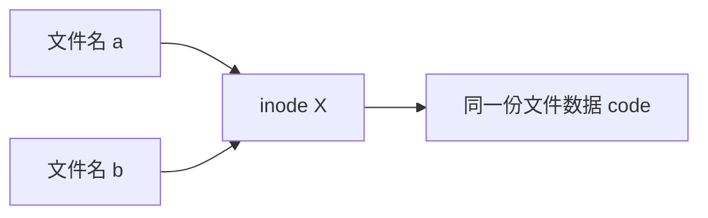

# 第一课总结

## 1. <mark>工作流</mark>


## 2. Linux 与 Shell

- Linux 是操作系统内核，Ubuntu（对 ROS 兼容性较好）是发行版。
- Shell 接收终端输入的命令，解释后交给 Linux 执行。


## 3. Vim

### 1. Vim是文本编辑器，用来编辑内容。

- `i`输入模式
- `Esc`正常模式
- `:`命令行模式
- `v`可视模式
### 2. 常用指令
- `y`复制
- `p`粘贴

## 4. Shell

### 4.1 命令结构

Shell 命令的基本形式：

```text
命令 [选项] [参数]
```

常见示例：

| 命令 | 选项 | 参数 | 含义 |
| --- | --- | --- | --- |
| `ls` | `-la` | `~/project` | 列出目录中的全部内容 |
| `rm` | `-r` | `project` | 递归删除目录及其内容 |

### 4.2 条件比较

| 运算符 | 含义 | 示例 |
| --- | --- | --- |
| `-lt` | 小于 | `[ "$a" -lt "$b" ]` |
| `-le` | 小于或等于 | `[ "$a" -le "$b" ]` |
| `-gt` | 大于 | `[ "$a" -gt "$b" ]` |
| `-ge` | 大于或等于 | `[ "$a" -ge "$b" ]` |
| `-eq` | 等于 | `[ "$a" -eq "$b" ]` |
| `-ne` | 不等于 | `[ "$a" -ne "$b" ]` |

### 4.3 输出与环境变量

```bash
echo "文本内容"
echo -e "hello\nworld"

printenv
echo "$PATH"
```

### 4.4 目录与路径

| 命令 | 作用 |
| --- | --- |
| `cd ~` | 切换到用户家目录 |
| `cd .` | 保持当前目录 |
| `cd ..` | 切换到上一级目录 |
| `pwd` | 显示当前逻辑路径，可能保留软链接名 |
| `pwd -P` | 显示解析软链接后的实际路径 |
| `cd -P 软链接名` | 进入软链接目标的实际目录 |

### 4.5 文件与目录操作

| 命令 | 作用 |
| --- | --- |
| `ls` | 显示目录内容 |
| `touch` | 创建空文件或更新时间戳 |
| `mkdir -p` | 创建目录，并按需创建父目录 |
| `mv` | 移动或重命名文件 |
| `rm -r` | 递归删除目录及其内容，使用时需谨慎 |

### 4.6 查看与过滤文件内容

```bash
head 文件名
head -n 5 文件名

tail 文件名
tail -n 5 文件名
tail -f 文件名

# 实时过滤新增内容
tail -f 文件名 | grep "关键词"
```

### 4.7 重定向、管道与命令连接

| 写法 | 作用 |
| --- | --- |
| `命令 > 文件` | 覆盖写入文件 |
| `命令 >> 文件` | 追加写入文件 |
| `命令1 \| 命令2` | 将前一命令的输出交给后一命令 |
| `命令1 && 命令2` | 前一命令成功后才执行后一命令 |

### 4.8 硬链接与软链接

创建链接：

```bash
ln 原文件 硬链接名
ln -s 原文件或目录 软链接名
```

硬链接与原文件使用同一个 inode，并指向同一份文件数据：



删除 `a` 不会影响通过 `b` 访问文件；删除 `b` 也不会影响 `a`。文件数据只有在最后一个硬链接被删除时才会释放。

软链接拥有独立的 inode，其中保存的是目标文件的路径：


删除目标文件 `a` 后，软链接 `b` 仍然存在，但会变成无法访问的失效链接；删除软链接 `b` 则不会影响目标文件 `a`。

删除软链接时，直接删除链接本身即可：

```bash
rm 软链接名
```

不要写成 `rm -r 软链接名/`。末尾的 `/` 可能使命令跟随软链接处理目标目录，从而导致误删。

## 5. Git

- 和工作流重复了，请参考[工作流](#1-工作流)

## 6. github

- 用于多人合作完成项目

