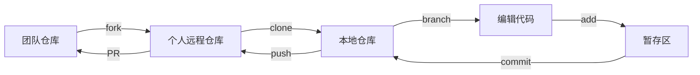
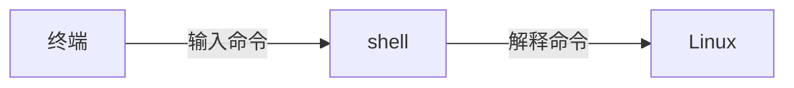

# 第一课总结

## 1. <mark>工作流</mark>

## 2. Linux

- Linux是操作系统内核，Ubuntu(Ros兼容性好)是发行版。

## 3. Vim

### 1. Vim是文本编辑器，用来编辑内容。

- `i`输入模式
- `Esc`正常模式
- `:`命令行模式
- `v`可视模式
###2. 常用指令
- `y`复制
- `p`粘贴

## 4. shell

1. shell命令的结构

|命令|选项|参数|
|:---|:---|:---|
|ls|-la|~/project|
|rm|-r|project|
|...|...|...|

2. 切换目录

|cd|作用|
|:---|:---|
|cd ~|返回家目录|
|cd .|当前目录|
|cd ..|返回上一级目录|

4. 常用命令

|命令|作用|
|:---|:---|
|touch|创建空文件|
|rm -r|删除|
|ls|显示文件|
|pwd|显示当前路径|
|mkdir -p|创建目录|
|mv|移动或重命名文件|
|\||将前面的输出传输给后面的命令|

## 5. Git

- 和工作流重复了，请参考[工作流](#1-工作流)

## 6. github

- 用于多人合作完成项目
