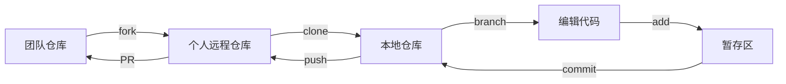
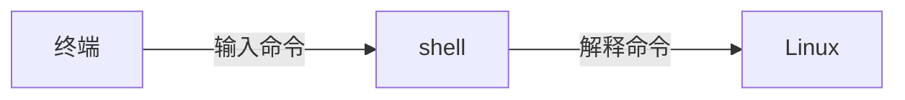

# 第一课总结

## 1. <mark>工作流</mark>

## 2. Linux

- Linux是操作系统内核，Ubuntu(Ros兼容性好)是发行版。

## 3. Vim

- Vim是文本编辑器，用来编辑内容。

## 4. shell的命令结构
|命令  |选项  |参数     |
|:---|:---|:---|
|ls|-la|~/project|
|rm|-r|project|
|...|...|...|

## 5.
